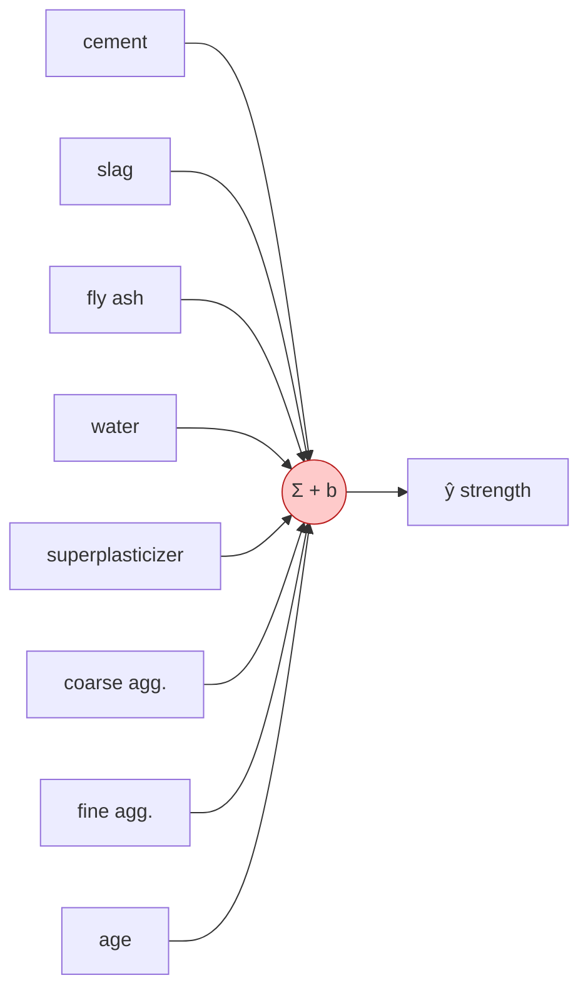
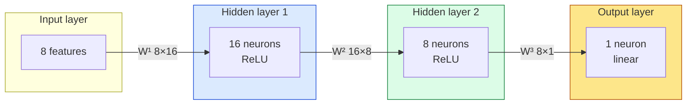
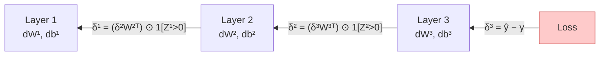
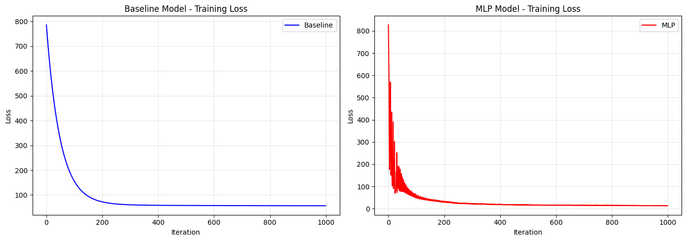
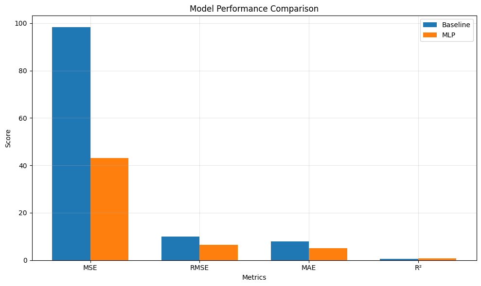

<div align="center">

# 🏗️ Concrete Compressive Strength Prediction

### Single-Neuron Linear Model vs. Multi-Layer Perceptron — both built from scratch in NumPy


*No scikit-learn models, no PyTorch, no TensorFlow — just matrices, gradients and a `for` loop.*

</div>

---

## 📑 Table of Contents

1. [Problem](#1--problem)
2. [Data Info](#2--data-info)
3. [Solutions Used](#3--solutions-used)
   - [3a. Single-Neuron Perceptron (Baseline)](#3a-single-neuron-perceptron-baseline)
   - [3b. Multi-Layer Perceptron (Deep Feed-Forward Network)](#3b-multi-layer-perceptron-deep-feed-forward-network)
   - [Why an MLP finds better patterns: breadth & depth](#-why-an-mlp-finds-better-patterns-breadth--depth)
4. [Evaluation Results](#4--evaluation-results)
5. [Analysis](#5--analysis)
6. [Repository Structure](#6--repository-structure)
7. [How to Run](#7--how-to-run)
8. [Implementation Notes & Limitations](#8--implementation-notes--limitations)
9. [Possible Next Steps](#9--possible-next-steps)
10. [References](#10--references)

---

## 1. 🎯 Problem

**Predict the compressive strength of concrete (in MPa) from its mix composition and age.**

Concrete underpins buildings, bridges and other infrastructure, and its compressive strength governs the **safety and durability** of the structure. The standard way to know that strength is to cast samples and physically test them, which takes roughly a month (28 days of curing). A reliable data-driven model can estimate strength from the recipe in seconds, helping construction firms plan and accelerate project timelines.

| | |
|---|---|
| **Task type** | Supervised **regression** |
| **Input** | 8 numerical features (ingredient quantities + age) |
| **Output** | Compressive strength (MPa) |
| **Primary metric** | **RMSE** — it penalises large errors heavily, and in structural design a large *under*-estimate of strength is the dangerous failure mode |
| **Supporting metrics** | MSE, MAE, R² |


---

## 2. 📊 Data Info

- **Name:** Concrete Compressive Strength
- **Source:** [UCI Machine Learning Repository](https://archive.ics.uci.edu/dataset/165/concrete+compressive+strength) (originally Yeh, 1998)
- **Size:** 1,030 samples × 8 features + 1 target
- **Quality:** no missing values, no categorical variables — everything is numeric

### Features

| # | Feature | Description | Unit | Mean | Std | Min | Max |
|:-:|---|---|:-:|--:|--:|--:|--:|
| 1 | `cement` | Cement | kg/m³ | 281.17 | 104.51 | 102.0 | 540.0 |
| 2 | `blast_furnace_slag` | Blast furnace slag | kg/m³ | 73.90 | 86.28 | 0.0 | 359.4 |
| 3 | `fly_ash` | Fly ash | kg/m³ | 54.19 | 64.00 | 0.0 | 200.1 |
| 4 | `water` | Water | kg/m³ | 181.57 | 21.35 | 121.8 | 247.0 |
| 5 | `superplasticizer` | Superplasticizer | kg/m³ | 6.20 | 5.97 | 0.0 | 32.2 |
| 6 | `coarse_aggregate` | Coarse aggregate | kg/m³ | 972.92 | 77.75 | 801.0 | 1145.0 |
| 7 | `fine_aggregate` | Fine aggregate | kg/m³ | 773.58 | 80.18 | 594.0 | 992.6 |
| 8 | `age` | Age of the sample | days | 45.66 | 63.17 | 1 | 365 |
| 🎯 | `concrete_compressive_strength` | **Target** | MPa | 35.82 | 16.71 | 2.33 | 82.60 |

> 💡 Many mixes legitimately contain **0** slag, fly ash or superplasticizer (the 25th percentile of each is 0), so those zeros are real "ingredient not used" values, not missing data.

### Preprocessing pipeline


| Split | Samples |
|---|--:|
| Train | 824 |
| Test | 206 |

Features are standardised to zero mean / unit variance using statistics from the **training set only**, then applied to the test set — this avoids data leakage. The target is left in its original MPa units.

---

## 3. 🧠 Solutions Used

Two models are implemented **from scratch** and trained with identical settings so the comparison isolates one thing: *model capacity*.

| Setting | Value |
|---|---|
| Optimiser | Full-batch gradient descent |
| Learning rate | 0.01 |
| Iterations | 1,000 |
| Loss | Mean squared error with a ½ factor |
| Random seed | 42 |

**Loss function (shared by both models):**

$$
\mathcal{L} = \frac{1}{2N}\sum_{i=1}^{N}\left(\hat{y}_i - y_i\right)^2
$$

(The ½ simply cancels the 2 that appears when differentiating the square.)

---

### 3a. Single-Neuron Perceptron (Baseline)

#### Architecture

One neuron, **no hidden layer, no activation function** (identity). This is exactly **linear regression** trained by gradient descent.



| Property | Value |
|---|---|
| Architecture | `[8 → 1]` |
| Parameters | 8 weights + 1 bias = **9** |
| Activation | None (identity) |
| Weight init | Small random values, $\mathcal{N}(0,\,0.01^2)$; bias = 0 |

#### How it is built

`BaselineModel` keeps a weight vector `w` and a scalar bias `b`, and loops for `n_iterations`:

1. **Forward pass** — compute predictions
2. **Loss** — compute the ½-MSE
3. **Gradients** — compute $\partial\mathcal{L}/\partial \mathbf{w}$ and $\partial\mathcal{L}/\partial b$
4. **Update** — step against the gradient
5. **Log** the loss in `loss_history`

#### Math

**Forward pass**

$$
\hat{y} = \mathbf{w}^{\top}\mathbf{x} + b
\qquad\Longrightarrow\qquad
\hat{\mathbf{y}} = X\mathbf{w} + b\,\mathbf{1}
$$

**Gradients** (with error $\mathbf{e} = \hat{\mathbf{y}} - \mathbf{y}$)

$$
\frac{\partial \mathcal{L}}{\partial \mathbf{w}} = \frac{1}{N}X^{\top}\mathbf{e},
\qquad
\frac{\partial \mathcal{L}}{\partial b} = \frac{1}{N}\sum_{i=1}^{N} e_i
$$

**Update rule** (learning rate $\eta$)

$$
\mathbf{w} \leftarrow \mathbf{w} - \eta\,\frac{\partial \mathcal{L}}{\partial \mathbf{w}},
\qquad
b \leftarrow b - \eta\,\frac{\partial \mathcal{L}}{\partial b}
$$

> The loss surface of linear regression is a convex bowl, so gradient descent converges smoothly to the single global minimum — which is why this loss curve is a clean exponential decay.

---

### 3b. Multi-Layer Perceptron (Deep Feed-Forward Network)

#### Architecture

A fully-connected feed-forward network with **two hidden layers** (ReLU) and a **linear output** (the right choice for unbounded regression targets).



| Layer | Shape | Activation | Parameters |
|---|:-:|:-:|--:|
| Input | 8 | — | — |
| Hidden 1 | 8 → 16 | ReLU | 8·16 + 16 = **144** |
| Hidden 2 | 16 → 8 | ReLU | 16·8 + 8 = **136** |
| Output | 8 → 1 | Linear | 8·1 + 1 = **9** |
| **Total** | `[8, 16, 8, 1]` | | **289** |

| Property | Value |
|---|---|
| Weight init | **He initialisation**, $W \sim \mathcal{N}\!\left(0,\ 2/n_{\text{in}}\right)$ — designed for ReLU layers |
| Bias init | Zeros |
| Design shape | *Expand then compress*: 8 → 16 widens the representation, 16 → 8 distils it before the final prediction |

#### How it is built

`MLP` is a class with five clearly separated parts:

| Method | Responsibility |
|---|---|
| `initialize_parameters()` | He-initialise `W1…W3`, zero `b1…b3` |
| `forward_propagation(X)` | Run the layers, **cache** every `Z` and `A` for backprop |
| `compute_loss(...)` | ½-MSE |
| `backward_propagation(X, y)` | Reverse-mode chain rule using the cache → gradients for every layer |
| `update_parameters(grads)` | Gradient-descent step |

`fit()` repeats: **forward → loss → backward → update → log loss**.

#### Math: forward propagation

For layer $l = 1,\dots,L$ (here $L=3$), with the input $A^{[0]} = X$ and the notation used in the code (rows = samples):

$$
Z^{[l]} = A^{[l-1]}\,W^{[l]} + b^{[l]}
$$

$$
A^{[l]} =
\begin{cases}
\mathrm{ReLU}\!\left(Z^{[l]}\right) = \max\!\left(0,\,Z^{[l]}\right) & l < L \quad\text{(hidden)}\\[4pt]
Z^{[l]} & l = L \quad\text{(linear output)}
\end{cases}
$$

The prediction is $\hat{\mathbf{y}} = A^{[L]}$. Written out for this network:

$$
\hat{y} = \Big(\mathrm{ReLU}\big(\mathrm{ReLU}(X W^{[1]} + b^{[1]})\,W^{[2]} + b^{[2]}\big)\Big)W^{[3]} + b^{[3]}
$$

#### Math: backpropagation (brief)

Backprop is the **chain rule applied layer by layer from the output backwards**, re-using the `Z`/`A` values cached in the forward pass. Define the error signal at layer $l$ as $\delta^{[l]} = \partial \mathcal{L}/\partial Z^{[l]}$ (un-normalised; the $1/m$ is applied when forming the weight gradients, exactly as in the code).

**① Output layer** — with a linear output and ½-MSE, the derivative is simply the prediction error:

$$
\delta^{[L]} = \hat{\mathbf{y}} - \mathbf{y}
$$

**② Parameter gradients** for any layer $l$ (m = number of samples):

$$
\frac{\partial \mathcal{L}}{\partial W^{[l]}} = \frac{1}{m}\,\big(A^{[l-1]}\big)^{\top}\delta^{[l]}
\qquad\qquad
\frac{\partial \mathcal{L}}{\partial b^{[l]}} = \frac{1}{m}\sum_{\text{rows}}\delta^{[l]}
$$

**③ Propagate the error backwards** to the previous layer — multiply by the transposed weights, then gate by the ReLU derivative:

$$
\delta^{[l-1]} = \left(\delta^{[l]}\,\big(W^{[l]}\big)^{\top}\right)\odot\ \mathbb{1}\!\left[Z^{[l-1]} > 0\right]
$$

where $\odot$ is element-wise multiplication and $\mathrm{ReLU}'(z)=\mathbb{1}[z>0]$.

**④ Update** every layer:

$$
W^{[l]} \leftarrow W^{[l]} - \eta\,\frac{\partial \mathcal{L}}{\partial W^{[l]}},
\qquad
b^{[l]} \leftarrow b^{[l]} - \eta\,\frac{\partial \mathcal{L}}{\partial b^{[l]}}
$$



> 🔁 **Intuition:** ReLU acts as a *gate*. If a neuron was "off" ($Z \le 0$) for a sample, no gradient flows through it for that sample; if it was "on", the error passes through unchanged. The network therefore learns a *different piecewise-linear function* for each region of the input space.

---

### 🔍 Why an MLP finds better patterns: breadth & depth

A single neuron computes **one weighted sum**: $\hat{y} = \mathbf{w}^\top\mathbf{x}+b$. Geometrically, that is one flat hyperplane through the data. Every feature contributes **independently and additively** — doubling cement always adds the same amount of strength, no matter what the water content or age is. It has no way to represent *"it depends"*.

Real concrete chemistry is full of "it depends": the effect of cement depends on the water–cement ratio, and strength grows non-linearly (and saturates) with age. An MLP fixes this along two complementary axes.

#### ↔️ Breadth (width): many detectors in parallel

Each neuron in a hidden layer has its **own weights**, so it looks at the inputs from a **different angle** — one neuron might respond to "high cement, low water", another to "old sample with slag". A layer of 16 neurons gives 16 different learned feature detectors **computed simultaneously** from the same 8 inputs.

- More width → more distinct features → more *shapes* the layer can combine.
- It re-represents the data in a new, richer space where the target becomes easier to predict. This learned re-representation *is* automatic **feature engineering**: we never hand-crafted `cement / water` or `log(age)`; the network is free to discover such combinations itself.

#### ⬇️ Depth (layers): features built from features

Stacking layers means the second layer's inputs are the **first layer's learned features**, not the raw inputs. Each layer composes the previous layer's output:

| Level | Sees | Can express |
|---|---|---|
| Raw input | 8 raw ingredient values | — |
| Hidden 1 | Raw ingredients | Simple blends and thresholds (e.g. a water–cement-like trade-off) |
| Hidden 2 | Hidden-1 features | Interactions *between* those blends (higher-order combinations) |
| Output | Hidden-2 features | A weighted sum of the highest-level features → strength |

- **Depth gives hierarchical, compositional features** — complex patterns are assembled from simpler ones.
- **Depth is exponentially efficient.** The number of distinct linear pieces a ReLU network can carve the input space into grows *exponentially with depth* but only *polynomially with width*, so deep networks can represent intricate functions with far fewer neurons than a very wide shallow one.

#### ⚡ The role of non-linearity

Width and depth only help **because of the activation function**. Without ReLU, stacked layers collapse:

$$
(XW^{[1]})W^{[2]}W^{[3]} = X\underbrace{\big(W^{[1]}W^{[2]}W^{[3]}\big)}_{\text{just one matrix}}
$$

…which is the single-neuron model again. ReLU's "bend" at zero is what lets the network turn a stack of linear maps into a flexible **piecewise-linear function**. By the *universal approximation theorem*, even one sufficiently wide hidden layer can approximate any continuous function.

#### 📋 Side-by-side

| | Single neuron | MLP `[8, 16, 8, 1]` |
|---|---|---|
| Learned function | One hyperplane | Piecewise-linear surface |
| Feature interactions | ❌ None (purely additive) | ✅ Learned automatically |
| Breadth | 1 unit | 16 + 8 parallel feature detectors |
| Depth | 1 layer | 3 weight layers (2 hidden) |
| Feature engineering | Manual only | Learned |
| Parameters | 9 | 289 |
| Loss surface | Convex (one minimum) | Non-convex (many minima / saddle points) |
| Interpretability | ✅ High (one coefficient per feature) | ⚠️ Lower |
| Cost per iteration | Low | Higher |

---

## 4. 📈 Evaluation Results

Both models were evaluated on the same **206 held-out test samples**.

### Test-set metrics

| Metric | Baseline (single neuron) | MLP `[8,16,8,1]` | Change |
|---|--:|--:|--:|
| **RMSE** ⭐ *(primary)* | 9.913 MPa | **6.559 MPa** | ▼ 3.354 MPa (**−33.8 %**) |
| MSE | 98.269 | **43.020** | ▼ 56.2 % |
| MAE | 7.934 MPa | **5.039 MPa** | ▼ 36.5 % |
| R² | 0.6186 | **0.8330** | ▲ +0.2144 |

### Training summary

| | Baseline | MLP |
|---|--:|--:|
| Parameters | 9 | 289 |
| Initial loss | 784.99 | 826.87 |
| Final loss | 56.72 | **13.11** |
| Training time | 0.57 s | 1.04 s |
| Loss decreased? | ✅ | ✅ |

> 🏆 **The MLP wins on every metric** — the single-neuron model explains **61.9 %** of the variance in strength, the MLP explains **83.3 %**, for about 2× the training time.

### Training loss curves

<p align="center">
  
</p>

The baseline decays smoothly and then plateaus at a high loss (limited by capacity). The MLP is far noisier in the first ~100 iterations, because with full-batch gradient descent and an un-scaled target in MPa its early steps overshoot, before settling at a much lower loss.

### Metric comparison

<p align="center">
  
</p>

---

## 5. 📝 Analysis

*(Copied verbatim from the analysis cell in the notebook.)*

### 1. Which model performed better and by how much?

From the metric comparisons and visualizations made on the Baseline and MLP models, we find that MLP outperforms the Baseline linear Model in every single metric. Out of the metrics calculated, we defined the most important and primary metric to be RMSE because penalization of large errors is extremely important in concrete strength analysis. In RMSE alone the MLP's predictions are off by 6.56 MPa on average versus the SLP's 9.91 MPa. In structural engineering terms, that ~3.5 MPa difference is significant and could translate to real safety margins.

### 2. Why Did MLP Outperform Baseline Linear Model?

MLP outperformed the Baseline Model mainly because of its capability to learn non-linear patterns in data. Concrete compressive strength is governed by complex chemical interactions — cement hydration, water-cement ratio effects, superplasticizer interactions with fine aggregates, and the highly non-linear role of age. The Baseline linear model with f(x) = x can only learn linear relationships via a hyperplane through the data irrespective of how well gradient descent optimizes the weights. MLP, however, with architecture [8, 16, 8, 1] (2 hidden layers) with ReLU activation introduces approximation of non-linear boundaries to learn the relationships between data. The hidden layer of 16 neurons learns feature interactions (e.g. cement × age, water × superplasticizer), while the compression to 8 neurons distills these into higher-order representations. The R² jump from 0.618 → 0.833 is the clearest evidence: the SLP explains only 61.8% of variance in concrete strength, while the MLP explains 83.3% — a direct consequence of its ability to model the non-linear chemistry.

### 3. Computational Cost Difference

The MLP is more expensive per iteration due to:

- Two forward passes through hidden layers vs one in SLP
- Backpropagation through 3 layers with ReLU derivative computations vs direct gradient in SLP
- 289 parameters being updated vs 9 in SLP

However, looking at the loss curves, the MLP's loss drops far more steeply in early iterations — it converges to a much lower loss in the same 1000 iterations. So while the MLP costs more per iteration, it delivers dramatically more value per iteration. The trade-off heavily favors MLP here.

### 4. Surprising Findings and Challenges

The most visually surprise finding is the MLP loss curve — unlike the smooth exponential decay of the Linear Model, the MLP shows violent oscillations in early iterations (loss spiking between ~50 and ~800 in the first 100 iterations) before stabilizing. Another notable finding is that the Linear Model's loss curve plateaus around 60–70 and refuses to go lower regardless of further iterations — underfitting due to insufficient model capacity. The MLP converges to a loss near 20, confirming it has the capacity to fit the underlying data distribution.

### 5. Insights Gained

Linear models are a special case of neural networks, and adding non-linear hidden layers strictly expands what is learnable. The Linear Model (Single Layer Perceptron - SLP) is essentially the MLP with no hidden layers and linear activation — and its performance ceiling is determined entirely by how linear the problem is. For concrete strength prediction specifically, the data reflects real-world chemistry that follows non-linear physical laws. No amount of hyperparameter tuning, more iterations, or better learning rates would allow the SLP to bridge the 0.215 R² gap — it is a fundamental architectural limitation, not a training limitation. This is precisely why MLP is the right tool for this problem.

---

## 6. 📁 Repository Structure

The notebook reads its data from `../data/concrete_data.csv`, so the layout below works out of the box:

```text
.
├── README.md
├── assets/
│   ├── loss_curves.png
│   └── metrics_comparison.png
├── data/
│   └── concrete_data.csv          # download separately (see below)
└── notebooks/
    └── concrete_compressive_strength.ipynb
```

---

## 7. ▶️ How to Run

**1. Clone the repo**

```bash
git clone <your-repo-url>
cd <your-repo-folder>
```

**2. Install the dependencies**

```bash
pip install numpy pandas matplotlib scikit-learn jupyter
```

> `scikit-learn` is used **only** for `train_test_split` and `StandardScaler`. Both models themselves use nothing but NumPy.

**3. Get the data**

Download the dataset from the [UCI repository](https://archive.ics.uci.edu/dataset/165/concrete+compressive+strength) and save it as `data/concrete_data.csv`.

The notebook expects these **snake_case column names**, so rename the raw UCI headers if needed:

```text
cement, blast_furnace_slag, fly_ash, water, superplasticizer,
coarse_aggregate, fine_aggregate, age, concrete_compressive_strength
```

**4. Run the notebook**

```bash
jupyter notebook notebooks/concrete_compressive_strength.ipynb
```

Then choose *Kernel → Restart & Run All*. Everything is seeded with `42`, so results are reproducible.

---

## 8. ⚙️ Implementation Notes & Limitations

- **Single train/test split, single seed.** The numbers above come from one run. Cross-validation or multiple seeds would give error bars.
- **No separate validation set.** Hyper-parameters (architecture, learning rate, iterations) were fixed up-front rather than tuned, and the test set was used only for the final report.
- **Un-normalised target.** The target is left in MPa while the inputs are standardised. This is the main reason for the early loss spikes in the MLP; scaling the target (or using a smaller learning rate / gradient clipping) would make training smoother.
- **Possible overfitting gap.** The MLP's final training loss of 13.11 corresponds to a training MSE of ≈ 26.2 (the loss includes the ½ factor), versus a test MSE of 43.0. The gap is moderate but worth watching if the network is made larger.
- **Full-batch gradient descent only** — no mini-batches, momentum or Adam.
- **Dataset size.** With 1,030 rows, larger networks would overfit quickly.

---

## 9. 🚀 Possible Next Steps

- [ ] Scale the target and compare loss-curve stability
- [ ] Add mini-batch SGD, momentum or Adam
- [ ] Tune depth, width and learning rate on a validation set / with cross-validation
- [ ] Add L2 regularisation or early stopping
- [ ] Engineer domain features (e.g. **water / cement ratio**, `log(age)`) and see whether the linear model closes the gap
- [ ] Compare against tree ensembles (Random Forest, Gradient Boosting)
- [ ] Add predicted-vs-actual and residual plots

---

## 10. 📚 References

- Yeh, I-C. (1998). *Modeling of strength of high-performance concrete using artificial neural networks.* Cement and Concrete Research, 28(12), 1797–1808.
- Dua, D. & Graff, C. — [UCI Machine Learning Repository](https://archive.ics.uci.edu/dataset/165/concrete+compressive+strength)
- He, K. et al. (2015). *Delving Deep into Rectifiers: Surpassing Human-Level Performance on ImageNet Classification.* (He initialisation)
- Goodfellow, I., Bengio, Y., Courville, A. (2016). *Deep Learning.* MIT Press — chapters on feed-forward networks and backpropagation.

---

<div align="center">

**Author:** Sayan Basu

⭐ If you found this useful, consider giving the repo a star.

</div>
